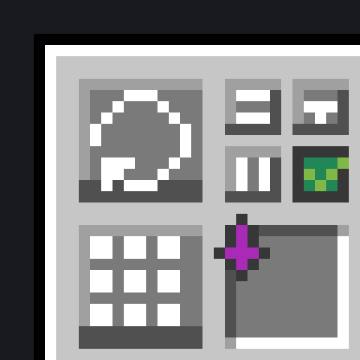
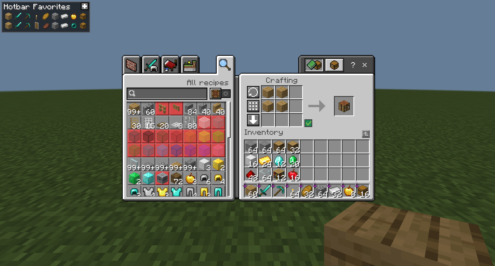

# Inventory Utils

[English](README.md) | [简体中文](README.zh-CN.md) | [繁體中文](README.zh-TW.md)





Minecraft 統合版のインベントリ操作をまとめた [LeviLamina](https://github.com/LiteLDev/LeviLamina) 向けのクライアント Mod です。Java 版の Mod [Item Scroller](https://github.com/sakura-ryoko/itemscroller) と [Inventory Profiles Next](https://codeberg.org/Inventory-Profiles-Next-Mod/IPN) を移植し、クラフトツール に相当する機能（独自の実装）とホットバーのお気に入りを加えています。

> Item Scroller・malilib・Inventory Profiles Next・libIPN・クラフトツール の作者、および Mojang・Microsoft とは関係のない、非公式の移植です。この Mod の問題を本家の作者に問い合わせないでください。

## 必要なもの

| | 版 |
|---|---|
| Minecraft 統合版 | 1.26.60（Windows） |
| LeviLamina | 26.60.x |

クライアント Mod です。キーボード・マウスと、PC のクラシック UI で使います。

## 導入

**lip**

```
lip install github.com/ch1-k-mc/InventoryUtils-Bedrock
```

LeviLamina（client）のゲームフォルダで実行します。

**手動**: [Releases](../../releases) から `InventoryUtils-client-windows-x64.zip` をダウンロードし、`InventoryUtils` フォルダを `mods/` に置きます。

## 使い方

`A+B` は「`A` を押しながら `B`」です。

| キー | 動作 |
|---|---|
| `R+C` | 設定画面を開く（`/invutils gui` でも開く） |
| `R` | マウスの下のインベントリやチェストを並べ替える |
| スタックの上でホイール | アイテムを反対側へ移す |
| `Shift` + 左ドラッグ | なぞったスタックを移す |
| `Alt` + スロットを左クリック | スロットのロック / 解除 |
| `R+P` | 今の装備をプロファイルに保存する |

すべてのキー・設定画面・コマンド・設定ファイルは [使い方](docs/USAGE.ja.md) を見てください。

## 機能

- **Item Scroller**: ホイール・ドラッグ・キーの組み合わせで移動・廃棄・クラフト。クリエイティブでも動く（`enableInCreative`、既定オン）
- **Inventory Profiles Next**: 並べ替え・全部移動・スロットのロック・自動補充・プロファイル・連続クラフト・村人の取引のお気に入り
- **クラフトツール 相当**: 作業台での回す・ならす・広げる・クリア・圧縮・展開
- **ホットバーのお気に入り**: ホットバー全体を保存して呼び出す（JEI 不要）
- 機能ごとのタブを持つ 1 つの設定画面
- 英語・日本語・中国語（簡体字・繁体字）

一覧は [機能](docs/FEATURES.ja.md) を見てください。

## ビルド

[xmake](https://xmake.io)、Visual Studio 2022 以降、clang-cl が必要です。

```
xmake f -m release -y
xmake
```

`bin/InventoryUtils/` に出力されます。

## ライセンス

[AGPL-3.0-only](LICENSE)。Item Scroller・malilib（LGPL-3.0）と Inventory Profiles Next・libIPN（AGPL-3.0-or-later）をもとにしています。詳しくは [NOTICE](NOTICE.md)。
