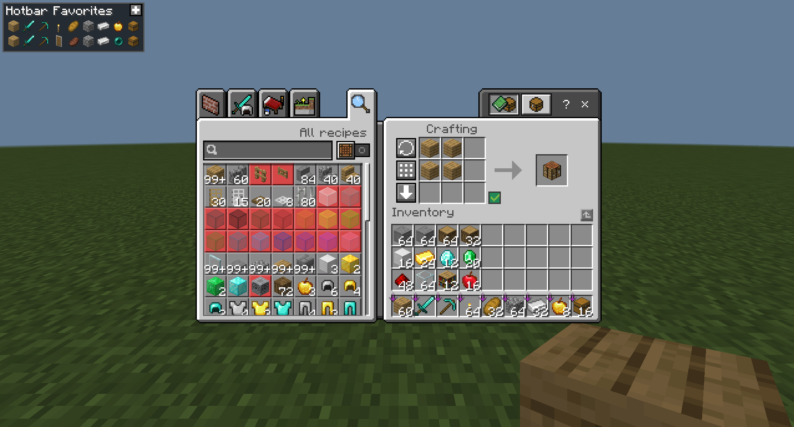

# Inventory Utils

[日本語](README.ja.md) | [简体中文](README.zh-CN.md) | [繁體中文](README.zh-TW.md)



Inventory tools for Minecraft: Bedrock Edition in one [LeviLamina](https://github.com/LiteLDev/LeviLamina) client mod. It ports the Java Edition mods [Item Scroller](https://github.com/sakura-ryoko/itemscroller) and [Inventory Profiles Next](https://codeberg.org/Inventory-Profiles-Next-Mod/IPN), and adds Crafting Tools, an independently written set of crafting grid features equivalent to [Crafting Tweaks](https://www.curseforge.com/minecraft/mc-mods/crafting-tweaks), and hotbar favorites.

> This is an unofficial port, not affiliated with the authors of Item Scroller, malilib, Inventory Profiles Next, libIPN or Crafting Tweaks, or with Mojang or Microsoft. Please do not report issues with this mod to them.

## Requirements

| | Version |
|---|---|
| Minecraft: Bedrock Edition | 1.26.60 (Windows) |
| LeviLamina | 26.60.x |

Client mod. Requires keyboard and mouse with the PC classic UI.

## Installation

**lip**

```
lip install github.com/ch1-k-mc/InventoryUtils-Bedrock
```

Run it in the game directory of your LeviLamina client.

**Manual**: download `InventoryUtils-client-windows-x64.zip` from [Releases](../../releases) and extract the `InventoryUtils` folder into `mods/`.

## Usage

`A+B` means hold `A` and press `B`.

| Key | Action |
|---|---|
| `R+C` | Open the settings screen (also `/invutils gui`) |
| `R` | Sort the inventory or container under the mouse |
| Mouse wheel on a stack | Move items to the other side |
| `Shift` + left-drag | Move the stacks you drag over |
| `Alt` + left-click a slot | Lock / unlock the slot |
| `R+P` | Save the current equipment as a profile |

See [Usage](docs/USAGE.md) for all keys, the settings screen, commands and config files.

## Features

- **Item Scroller**: move, drop and craft with the wheel, drags and key combinations; also works in Creative (`enableInCreative`, on by default)
- **Inventory Profiles Next**: sorting, move all, slot locks, auto refill, profiles, continuous crafting, villager trade favorites
- **Crafting Tools**: rotate, balance, spread, clear, compress and decompress on the crafting table
- **Hotbar favorites**: save and recall whole hotbars, no JEI required
- One settings screen with a tab for each feature set
- English, Japanese and Chinese (Simplified / Traditional)

See [Features](docs/FEATURES.md) for the full list.

## Building

Requires [xmake](https://xmake.io), Visual Studio 2022 or later, and clang-cl.

```
xmake f -m release -y
xmake
```

The mod is output to `bin/InventoryUtils/`.

## License

[AGPL-3.0-only](LICENSE). Based on Item Scroller and malilib (LGPL-3.0), and Inventory Profiles Next and libIPN (AGPL-3.0-or-later). See [NOTICE](NOTICE.md).
