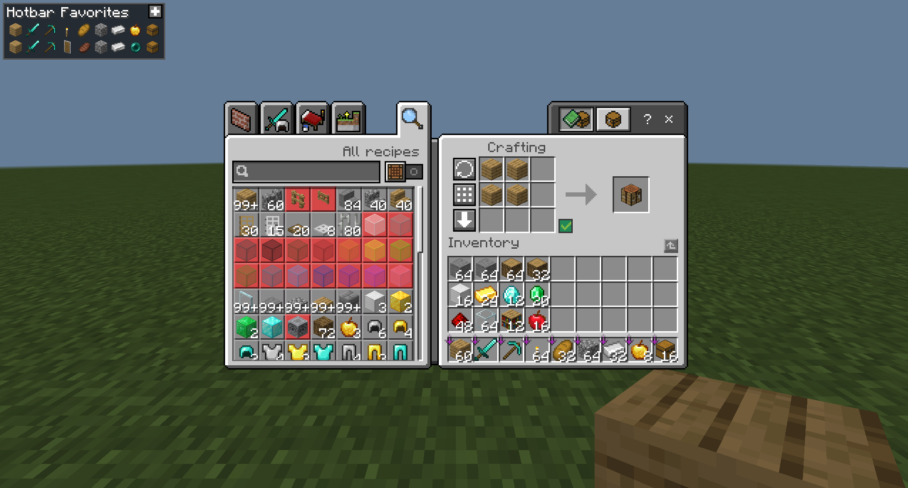

# Inventory Utils

[English](README.md) | [日本語](README.ja.md) | [繁體中文](README.zh-TW.md)



将 Minecraft 基岩版的物品栏操作整合到一个 [LeviLamina](https://github.com/LiteLDev/LeviLamina) 客户端模组中。本模组移植了 Java 版模组 [Item Scroller](https://github.com/sakura-ryoko/itemscroller) 和 [Inventory Profiles Next](https://codeberg.org/Inventory-Profiles-Next-Mod/IPN)，并加入了独立实现、功能相当于 [Crafting Tweaks](https://www.curseforge.com/minecraft/mc-mods/crafting-tweaks) 的“合成工具”以及快捷栏收藏。

> 这是非官方移植，与 Item Scroller、malilib、Inventory Profiles Next、libIPN、Crafting Tweaks 的作者以及 Mojang、Microsoft 无关。请勿就本模组的问题联系原作者。

## 运行要求

| | 版本 |
|---|---|
| Minecraft 基岩版 | 1.26.60（Windows） |
| LeviLamina | 26.60.x |

客户端模组。需使用键盘、鼠标和 PC 经典 UI。

## 安装

**lip**

```
lip install github.com/ch1-k-mc/InventoryUtils-Bedrock
```

请在 LeviLamina（client）的游戏目录中运行。

**手动**：从 [Releases](../../releases) 下载 `InventoryUtils-client-windows-x64.zip`，将其中的 `InventoryUtils` 文件夹放入 `mods/`。

## 使用方法

`A+B` 表示按住 `A` 再按 `B`。

| 按键 | 功能 |
|---|---|
| `R+C` | 打开设置界面（也可用 `/invutils gui`） |
| `R` | 整理鼠标所在的物品栏或容器 |
| 在物品堆上滚动滚轮 | 将物品移到另一侧 |
| `Shift` + 左键拖动 | 移动拖过的物品堆 |
| `Alt` + 左键点击槽位 | 锁定 / 解锁槽位 |
| `R+P` | 将当前装备保存为配置档 |

全部按键、设置界面、命令和配置文件请参阅[使用方法](docs/USAGE.zh-CN.md)。

## 功能

- **Item Scroller**：通过滚轮、拖动和组合键移动、丢弃、合成；创造模式下也可用（`enableInCreative`，默认开启）
- **Inventory Profiles Next**：整理、全部移动、槽位锁定、自动补充、配置档、连续合成、村民交易收藏
- **合成工具**：在工作台上旋转、均分、铺开、清空、压缩、解压
- **快捷栏收藏**：保存并调用整条快捷栏，无需 JEI
- 按功能分标签页的统一设置界面
- 英语、日语、中文（简体 / 繁体）

完整列表请参阅[功能](docs/FEATURES.zh-CN.md)。

## 构建

需要 [xmake](https://xmake.io)、Visual Studio 2022 或更高版本，以及 clang-cl。

```
xmake f -m release -y
xmake
```

模组输出到 `bin/InventoryUtils/`。

## 许可证

[AGPL-3.0-only](LICENSE)。基于 Item Scroller、malilib（LGPL-3.0）以及 Inventory Profiles Next、libIPN（AGPL-3.0-or-later）。详见 [NOTICE](NOTICE.md)。
