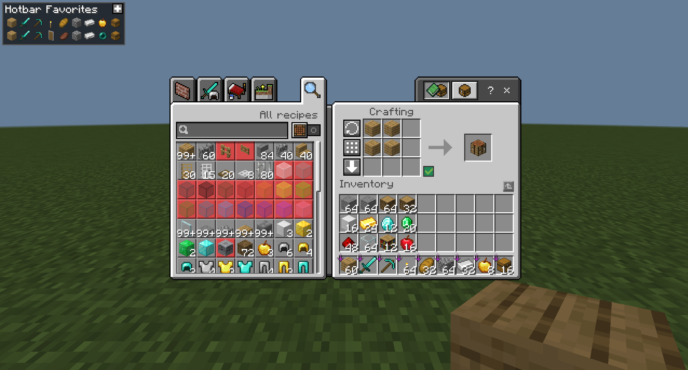

# Inventory Utils

[English](README.md) | [日本語](README.ja.md) | [简体中文](README.zh-CN.md)



將 Minecraft 基岩版的物品欄操作整合到一個 [LeviLamina](https://github.com/LiteLDev/LeviLamina) 用戶端模組中。本模組移植了 Java 版模組 [Item Scroller](https://github.com/sakura-ryoko/itemscroller) 與 [Inventory Profiles Next](https://codeberg.org/Inventory-Profiles-Next-Mod/IPN)，並加入獨立實作、功能相當於 [Crafting Tweaks](https://www.curseforge.com/minecraft/mc-mods/crafting-tweaks) 的「合成工具」與快捷列收藏。

> 這是非官方移植，與 Item Scroller、malilib、Inventory Profiles Next、libIPN、Crafting Tweaks 的作者以及 Mojang、Microsoft 無關。請勿就本模組的問題聯絡原作者。

## 執行需求

| | 版本 |
|---|---|
| Minecraft 基岩版 | 1.26.60（Windows） |
| LeviLamina | 26.60.x |

用戶端模組。需使用鍵盤、滑鼠與 PC 經典 UI。

## 安裝

**lip**

```
lip install github.com/ch1-k-mc/InventoryUtils-Bedrock
```

請在 LeviLamina（client）的遊戲資料夾中執行。

**手動**：從 [Releases](../../releases) 下載 `InventoryUtils-client-windows-x64.zip`，將其中的 `InventoryUtils` 資料夾放入 `mods/`。

## 使用方式

`A+B` 表示按住 `A` 再按 `B`。

| 按鍵 | 功能 |
|---|---|
| `R+C` | 開啟設定畫面（也可用 `/invutils gui`） |
| `R` | 整理滑鼠所在的物品欄或容器 |
| 在物品堆上滾動滾輪 | 將物品移到另一側 |
| `Shift` + 左鍵拖曳 | 移動拖過的物品堆 |
| `Alt` + 左鍵點擊欄位 | 鎖定 / 解鎖欄位 |
| `R+P` | 將目前裝備儲存為設定檔 |

所有按鍵、設定畫面、指令與設定檔請參閱[使用方式](docs/USAGE.zh-TW.md)。

## 功能

- **Item Scroller**：透過滾輪、拖曳與組合鍵移動、丟棄、合成；創造模式下也可使用（`enableInCreative`，預設開啟）
- **Inventory Profiles Next**：整理、全部移動、欄位鎖定、自動補充、設定檔、連續合成、村民交易收藏
- **合成工具**：在工作台上旋轉、均分、鋪開、清空、壓縮、解壓
- **快捷列收藏**：儲存並叫用整條快捷列，不需要 JEI
- 依功能分頁的統一設定畫面
- 英文、日文、中文（簡體 / 繁體）

完整清單請參閱[功能](docs/FEATURES.zh-TW.md)。

## 建置

需要 [xmake](https://xmake.io)、Visual Studio 2022 或更新版本，以及 clang-cl。

```
xmake f -m release -y
xmake
```

模組會輸出到 `bin/InventoryUtils/`。

## 授權

[AGPL-3.0-only](LICENSE)。基於 Item Scroller、malilib（LGPL-3.0）以及 Inventory Profiles Next、libIPN（AGPL-3.0-or-later）。詳見 [NOTICE](NOTICE.md)。
